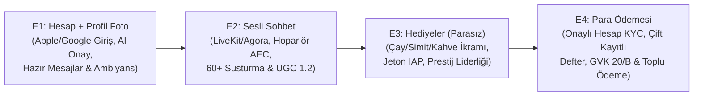

# Demli Kahve — "Kahve Havası" (Sosyal Katman, Sesli Sohbet, Hediye Ekonomisi ve Altyapı) Araştırma Raporu

> **Hazırlayan:** Gemini Argon (Görsel & Etkileşim Katmanı Planlayıcısı)  
> **Hedef Kitle:** 60+ yaş Türk kullanıcılar (Okey 101, Düz Okey, Tavla, Batak, Pişti)  
> **Mevcut Mimari:** Expo 58 / React Native 0.88 ([app/package.json](../../../app/package.json)), Node + Express + Socket.io ([server/package.json](../../../server/package.json)), Raspberry Pi + Cloudflare Tunnel ([docs/raspberry-pi-kurulum.md](../../../docs/raspberry-pi-kurulum.md)), yatay ekran 3 katlı yerleşim ([docs/tasarim/TASARIM.md](../../../docs/tasarim/TASARIM.md)).  
> **Kırmızı Çizgi:** Gerçek parayla kumar kesinlikle yoktur; oyun puanları sanaldır, satın alınamaz ve paraya çevrilemez ([PROMPT_LOCAL.md](../../../PROMPT_LOCAL.md)).

---

# 1. Odalarda Sesli Sohbet (Mikrofon + Hoparlör)

Gerçek bir mahalle kahvehanesinin en temel unsuru masadaki taş/zar sesinin yanında dönen muhabbettir. Ancak 60+ yaş grubunda telefon genellikle kulaklıksız, **hoparlör (hands-free)** modunda ve masaya bırakılarak ya da iki elle yatay tutularak kullanılır.

### Rakipler nasıl yapıyor

| Uygulama | Sesli Sohbet Modeli | Arayüz & Kontroller | Gelir / Kısıtlama |
|---|---|---|---|
| **Jawaker** | Masa içi gerçek zamanlı sesli sohbet (WebRTC tabanlı). | Oyuncu avatarının yanında mikrofon simgesi, konuşurken yeşil halka animasyonu, koltuk bazlı tek tıkla susturma (mute). | Eskiden tamamen VIP ("Jawaker باشا") özelliğiyken, masa başı etkileşimi artırmak için temel ses odaları yaygınlaştırıldı; özel sesli kulüplerde jeton/abonelik modeli var. |
| **Yalla Ludo** | 2 ve 4 kişilik oyun masalarında açık mikrofon + ayrıca oyun dışı "Sesli Sohbet Odaları" (Voice Chat Rooms). | Alt/üst köşede tek mikrofon ve hoparlör düğmesi. Rakip profiline dokununca "Sesi Kapat / Şikayet Et / Hediye Gönder" mini kartı açılır. | Masada ses ücretsizdir; sesli odalarda mikrofon koltuğuna oturma ve hediyeleşme ana gelir kapısıdır. |
| **101 Okey Plus (Zynga / Peak)** | Uzun süre yalnızca yazılı/hazır mesaj kullandı; sonrasında masa içi sesli sohbeti (belirli masa tiplerinde/arkadaş masalarında) açtı. | Avatar üstünde mikrofon aç/kapa ve hoparlör aç/kapa. | Çip ekonomisini koruma odaklı; tacizi önlemek için hızlı susturma ve şikayet ön planda. |
| **Hapi / Bigo Live / Tango** | 8–12 mikrofon koltuklu "Sesli Parti / Kahvehane Odası" mimarisi (Agora / ZEGO altyapısı). | Konuşanın avatarı etrafında ses şiddetine (dB) duyarlı dalga halkası (speaking indicator), oda sahibinin herkesi susturma (host mute) yetkisi. | Tamamen hediye (Jeton/Elmas) ekonomisiyle finanse edilir. |

### Önerimiz

1. **Altyapı Seçimi: Başlangıçta LiveKit Cloud (veya Agora Ücretsiz Kota) → Büyüyünce Kendi VPS'imizde Self-Hosted LiveKit.**
   - **Neden Raspberry Pi'de çalışmaz?** Mevcut Pi sunucusu ([docs/raspberry-pi-kurulum.md](../../../docs/raspberry-pi-kurulum.md)) internete **Cloudflare Tunnel** (`okey.lightsoldiergames.com`) veya **Tailscale Funnel** ile çıkıyor. Bu tüneller yalnızca TCP/HTTP/WebSocket trafiğini taşır; WebRTC'nin gecikmesiz ses için zorunlu kıldığı **ham UDP portlarını (`UDP 50000-60000`, `UDP 3478` TURN)** taşımaz. Sesi TCP tünelinden geçirmeye çalışmak hem paket takılmalarına (head-of-line blocking) hem de ev internetinin düşük upload hızında (10–20 Mbps) oyun sunucusunun kilitlenmesine yol açar.
   - **Adım 1 (Lansman / E2):** **Agora** (aylık ilk 10.000 katılımcı-dakika ücretsiz) veya **LiveKit Cloud** (ücretsiz Build katmanı: 5.000 WebRTC dakikası, ardından en ucuz dakika başı ücret) kullanılır.
   - **Adım 2 (Ölçeklenme):** Aylık ses faturası $20'ı geçtiği an Almanya (Hetzner Falkenstein) veya İstanbul lokasyonlu **€4,50/aylık (2 vCPU, 4 GB RAM, 20 TB trafik)** bir VPS üzerine Docker ile **Self-Hosted LiveKit Server + встроенный TURN** kurulur. Pi'deki Node.js sunucusu yalnızca JWT oda anahtarı (`AccessToken`) üretir; ses trafiği doğrudan VPS'ten akar.
2. **React Native / Expo Uyumu:**
   - Mevcut uygulama ([app/package.json](../../../app/package.json)) Expo 58 ve RN 0.88 kullanıyor.
   - `@livekit/react-native` (veya `react-native-agora`) **native modül** içerir (`react-native-webrtc`). Expo Go içinde çalışmaz; `app.json` içine Expo Config Plugin eklenerek **EAS Build / Development Build** (`npx expo run:android`, `npx expo run:ios`) ile derlenmesi gerekir. ([ORKESTRA.md](../../../docs/kahve/ORKESTRA.md) §6 gereği bu native modül eklemesi için kullanıcıdan açık onay alınacaktır).
3. **Hoparlörde Yankı Engelleme (Acoustic Echo Cancellation - AEC):**
   - 60+ kullanıcı kulaklık takmaz; sesi hoparlörden dışarı verir. Taş sesi ve rakibin sesi mikrofona geri girerse ıslık/yankı oluşur.
   - Çözüm: WebRTC'nin yazılımsal AEC'si yerine **donanımsal işletim sistemi AEC'si** zorlanmalıdır:
     - **iOS:** `AVAudioSessionCategoryPlayAndRecord` + **`AVAudioSessionModeVoiceChat`** + `AVAudioSessionCategoryOptionDefaultToSpeaker`. Bu mod iPhone'un donanımsal DSP yankı engelleyicisini devreye sokar.
     - **Android:** `AudioManager.MODE_IN_COMMUNICATION` + donanım `AcousticEchoCanceler`.
   - Ayrıca: Oyuncu kendi ekranında taş çekerken/atarken çıkan `.wav` efektlerinin mikrofona gitmemesi için WebRTC ses kanalında **NS (Noise Suppression - Gürültü Engelleme)** ve **AGC (Otomatik Kazanç Kontrolü)** açık tutulur; konuşulmayan anlarda **VAD/DTX (Sessizlikte Paket Göndermeme)** aktif edilir.
4. **60+ Yaş İçin Arayüz Tasarımı ([TASARIM.md](../../../docs/tasarim/TASARIM.md) ile Tam Uyumlu):**
   - **Bas-Konuş (PTT) mu, Açık Mikrofon mu?** 60+ kullanıcı okey taşını sürüklerken veya kart seçerken aynı anda başka bir düğmeye basılı tutamaz (**Bas-Konuş oyun içinde ergonomik değildir**). Doğru model **"Dokun-Aç / Dokun-Kapat (Toggle) Açık Mikrofon"** + varsayılan olarak masaya ilk oturulduğunda **Mikrofon Kapalı (Muted), Hoparlör Açık** başlamasıdır.
   - **Yerleşim ([TASARIM.md](../../../docs/tasarim/TASARIM.md) §2 Başlık Şeridi):**
     - Mevcut `Ses (48×48 pt)` düğmesinin yanına veya birleşik kontrol olarak **`🎤 Konuş (56×48 pt)`** düğmesi konur:
       - Kapalıyken: Soluk çerçeve, `🎤 Kapalı` (15 pt).
       - Açıkken: Yeşil (`#5fd07d`) zemin, `🎤 Açık` (15 pt, kalın).
     - **Kim Konuşuyor Göstergesi:** `Rakip Paneli (155×48 pt)` içinde konuşan oyuncunun kutusu etrafında **yeşil (`#5fd07d`) 3 pt çerçeve** yanar ve ismin yanında `🔊` simgesi belirir (sıra vurgusu olan sarı `#f2b632` ile karışmaması için konuşma göstergesi yeşil ses ikonu + sol rozet olarak ayrılır).
     - **Tek Tek Susturma ve Şikayet:** [TASARIM.md](../../../docs/tasarim/TASARIM.md)'de rakip panelleri şu an "Dokunulmaz" olarak tanımlıydı. Bunu güncelleyerek **Rakip Paneline (155×48 pt — dev dokunma hedefi!) tek dokunuşta** ortada büyük, 3 düğmeli bir **"Oyuncu Kartı"** açılır:
       1. `🔇 Sesi Kapat (Sustur)` (56 pt yükseklik, tek dokunuş)
       2. `☕ İkram Gönder` (56 pt yükseklik)
       3. `🚫 Engelle / Şikayet Et` (56 pt yükseklik, kırmızı ikincil)
5. **Moderasyon, Apple 1.2 UGC ve KVKK:**
   - **Kaydetmeme İlkesi (Ephemeral Voice):** Sesli sohbet sunucuda **kesinlikle kaydedilmez** (anlık SFU yönlendirmesi). Bu sayede KVKK kapsamında biyometrik/işitsel veri depolama yükümlülüğü ve depolama maliyeti doğmaz.
   - **Şikayet Anında Kanıt:** Şikayet edilen oyuncunun son 60 saniyedeki **oda meta verisi** (kim, hangi masada, ne kadar süre mikrofon açtı, kaç kişi tarafından susturuldu/şikayet edildi) kaydedilir. **3 farklı masada 3 farklı oyuncu tarafından "Küfür/ Hakaret" nedeniyle susturulan/şikayet edilen** oyuncunun mikrofon açma yetkisi otomatik olarak 24 saat (tekrarında kalıcı) kapatılır.
   - **Apple App Store Guideline 1.2 (UGC) Zorunlulukları:**
     1. İlk kez mikrofon açarken **Açık Rıza & Kahve Adabı Sözleşmesi** onayı ("Küfür, siyaset, dolandırıcılık yasaktır").
     2. Her oyuncunun yanında tek dokunuşla **Engelle (Block)** ve **Şikayet Et (Report)** düğmesi (Engellenen kişinin sesi anında kesilir ve bir daha aynı masaya eşleştirilmez).
     3. Şikayetleri 24 saat içinde inceleme mekanizması ve uygulama içinde ulaşılabilir **Destek / İletişim** bilgisi.
   - **KVKK:** Aydınlatma metninde ses verisinin yalnızca anlık iletişim amacıyla işlendiği, kayıt altına alınmadığı belirtilir. Bulut sağlayıcı (LiveKit Cloud / Agora) kullanılıyorsa sunucu bölgesi **AB (Frankfurt)** seçilir ve KVKK Madde 9 kapsamında Standart Sözleşme bildirimi yapılır; Türkiye içi VPS'te kendi LiveKit sunucumuz kurulursa **yurt dışına veri aktarımı hiç oluşmaz** (en temiz KVKK çözümü).

### Maliyet

**Hesap Birimi:** 4 kişilik masa, 1 saatlik oyun = **240 katılımcı-dakika** (`4 oyuncu × 60 dk`).  
*(Ses kodeği: Opus ~24 kbps, VAD/DTX açıkken masada aynı anda ortalama 1 kişi konuşur = ~32 MB/saat downstream veri).*

| Seçenek | Ücretsiz Kota | Birim Fiyat | 4 Kişilik Masa / 1 Saat Maliyeti | Ayda 1.000 Masa-Saati (240.000 dk) | Ayda 10.000 Masa-Saati (2,4M dk) |
|---|---|---|---|---|---|
| **Agora (Voice Calling)** | 10.000 dk / ay (~41 masa-saati) | $0,99 / 1.000 dk *(doğrulanmalı: $0,59–$0,99)* | **$0,238** (~8,20 TL) | **~$228 / ay** | **~$2.366 / ay** |
| **ZEGOCLOUD** | 10.000 dk (deneme) | $0,99 / 1.000 dk | **$0,238** (~8,20 TL) | **~$238 / ay** | **~$2.376 / ay** |
| **LiveKit Cloud** | 5.000 dk / ay (~21 masa-saati) | $0,0005/dk bağlantı + $0,12/GB trafik | **$0,124 – $0,136** (~4,50 TL) | **~$125 / ay** | **~$1.240 / ay** |
| **LiveKit Kendi Sunucumuz (VPS - Hetzner/TR)** | — | 2 vCPU / 4 GB RAM VPS (€4,50–€8/ay, 20 TB trafik dahil) | **~$0,0001** (< 0,01 TL) | **$6 – $10 / ay (Sabit)** | **$15 – $25 / ay (Sabit)** |

> **Sonuç:** Kendi VPS sunucumuzda açık kaynak `livekit-server` çalıştırmak, Agora/ZEGO'ya kıyasla maliyeti **%98 düşürür** (ayda $2.300 yerine $10).

### Riskler

- **Hoparlör Yankısı ve Gürültü:** Ucuz Android tablet/telefonlarda donanımsal AEC zayıf olabilir. *Önlem:* Konuşmayanların mikrofonunu otomatik kısan agresif VAD eşiği ve tek dokunuşla "Masadaki Herkesi Sustur" seçeneği.
- **Küfür ve Siyasi Tartışma:** Kahvehane ortamında el kaybedince sinirlenme yaygındır. *Önlem:* Varsayılan olarak mikrofonun kapalı başlaması, "Sadece Arkadaş Masalarında Ses" veya "Onaylı/Seviyeli Oyunculara Ses" seçeneği, otomatik çoklu şikayet susturması.
- **Oyun Performansı (60 FPS):** WebRTC ses işleme native thread'de çalışır, JS/Reanimated thread'ini bloke etmez; ancak eski cihazlarda ısınma yapabilir.

### Açık kararlar (kullanıcıya sorulacak)

1. Sesli sohbet **tüm açık salon masalarında** mı serbest olsun, yoksa ilk aşamada yalnızca **"Arkadaşlarla (Şifreli Masa)"** ve **"Sesli Masa"** olarak işaretlenmiş masalarda mı açılsın?
2. Başlangıçta sıfır sunucu bakımı için **LiveKit Cloud (ücretsiz kota ile)** mı başlayalım, yoksa doğrudan aylık ~$7 maliyetli bir **VPS kiralayıp kendi LiveKit sunucumuzu** mu kuralım?

---

# 2. Yazılı Sohbet, Hazır Mesajlar, Emoji Tepkileri ve Kahvehane Ortam Sesi

### Rakipler nasıl yapıyor

- **101 Okey Plus & Çanak Okey:** Oyun hızını kesmemek ve küfürü önlemek için masada **Hızlı Hazır Mesajlar** ("Seri oyna lütfen", "İyi oyunlar", "Eline sağlık", "Çaylar benden!") ve **Büyük Animasyonlu Emojiler** (gülme, ağlama, alkış, nazar boncuğu) en sık kullanılan iletişim aracıdır. Serbest yazılı sohbet çoğu masada ya kapalıdır ya da VIP/arkadaş şartına bağlıdır.
- **Jawaker:** Hem hazır söz kalıpları hem de sesli/görsel masa tepkileri (masa tıklatma, taş vurma) sunar.

### Önerimiz

1. **Serbest Yazılı Sohbet Yerine "Hazır Kahve Sözleri + Emoji Tepkileri" (İlk Aşamada):**
   - **Neden?** 60+ yaş kullanıcı için yatay ekranda ([TASARIM.md](../../../docs/tasarim/TASARIM.md) `812×375`) ekran klavyesi açıldığında **ekranın %65'i kapanır**, oyuncu ıstakasını ve masayı göremez, sıra süresini kaçırır. Üstelik serbest yazı; küfür, telefon numarası paylaşımı ve dolandırıcılık (IBAN isteme) riski doğurur.
   - **Çözüm:** Başlık şeridine veya eylem satırına tek bir **`💬 Söz (48×48 pt)`** düğmesi konur. Dokununca ekranı kapatmayan, 2 sütunlu dev butonlardan (en az 56 pt yükseklik, 18 pt yazı) oluşan **"Kahve Sözleri"** çekmecesi açılır:
     - *Selamlaşma:* "Selamünaleyküm", "Hoş bulduk", "Hayırlı oyunlar", "Eline sağlık"
     - *Oyun İçi:* "Sıra sende usta", "Taş gelmiyor!", "Bu el benim", "Maşallah"
     - *Kahve Havası:* "Garson, dört çay!", "Çaylar şirketten!", "Kısmet bir dahaki ele", "Eyvallah"
   - Seçilen söz, oyuncunun Rakip Paneli altında 3 saniye boyunca büyük konuşma balonu (17 pt, kalın) olarak görünür ve hafif bir bildirim sesi çıkarır.
   - **Spam Koruması:** Oyuncu başına **5 saniyede en fazla 1 hazır mesaj/emoji** sınırı (cooldown).
2. **Serbest Yazılı Sohbet (İsteğe Bağlı - Sadece Özel/Arkadaş Masalarında):**
   - İlla serbest yazı açılacaksa yalnızca **şifreli arkadaş masalarında** açılmalı; istemci ve sunucu tarafında Türkçe küfür/argo kara listesi (regex + kelime kökü filtresi) ve telefon numarası/IBAN maskeleme (`05\d{9}`, `TR\d{24}` engeli) zorunlu olmalıdır.
3. **Kahvehane Ortam Sesi (Ambiyans):**
   - [PROMPT_LOCAL.md](../../../PROMPT_LOCAL.md) §4'te belirtildiği üzere tekil efekt sesleri (`feedback.ts`, `expo-audio`) **50 KB altı `.wav`** dosyaları olarak kalmalıdır:
     - *Efektler:* Taş çekme/atma (`tak.wav`), ıstakaya dizme, çay bardağı karıştırma (`cay-kasigi.wav` — çay ikram edildiğinde çalar!), zar sallama/atma (`zar.wav`), kart şakırtısı (`kart.wav`).
   - **Arka Plan Kahve Uğultusu (İsteğe Bağlı):** Çok hafif (ses seviyesi %10–15), döngüsel (loop) bir kahvehane ambiyansı (uzaktan taş şakırtıları, kısık muhabbet, çay kaşığı sesi; 15 saniyelik mono 64 kbps `.m4a` veya `.mp3` ≈ **120 KB**).
   - **Kritik Kural:** Ortam sesi ayarlardan ayrı bir anahtarla (`Efekt Sesleri: Açık/Kapalı`, `Kahve Ortam Sesi: Açık/Kapalı`) kapatılabilmeli ve **masada sesli sohbet (mikrofon) açıldığı anda arka plan ortam sesi otomatik olarak %0'a kısılmalıdır** (ducking).

### Maliyet

- **Geliştirme ve Sunucu Maliyeti:** **$0 / ay.** Hazır mesajlar ve emojiler mevcut `Socket.io` bağlantısı üzerinden (`chat:quick` olayı, < 100 byte JSON) taşınır; Raspberry Pi'ye hiçbir ek yük getirmez. Ses dosyaları uygulama paketine gömülür (+300 KB).

### Riskler

- Arka plan ortam sesinin işitme cihazı kullanan veya işitme güçlüğü çeken 60+ kullanıcılarda yorgunluk yaratması. *Önlem:* Ortam sesi varsayılan olarak **sadece Kahve Salonu (Lobi) ekranında** kısık çalsın veya oyun içinde varsayılan kapalı olup tek tuşla açılsın.

### Açık kararlar (kullanıcıya sorulacak)

1. Serbest yazılı sohbeti (klavye ile yazma) tamamen devre dışı bırakıp **yalnızca Hazır Kahve Sözleri + Emojiler** ile mi çıkalım, yoksa şifreli arkadaş masalarında serbest yazıya izin verelim mi?

---

# 3. Hediye Ekonomisi ve Ay Sonu Para Ödemesi

Kullanıcıların uygulama içi satın alımla (IAP) **Jeton** alıp masadaki diğer oyunculara **Çay, Simit, Türk Kahvesi, Çiçek, Kehribar Tesbih** gibi hediyeler göndermesi ve bu hediyeleri toplayan kişilere ay sonunda nakit ödeme yapılması modelidir.

### Rakipler nasıl yapıyor

| Platform | İç Para Birimi Akışı | Hediye Alanın Payı (Net/Brüt) | Bekletme Süresi (Hold) | Min. Çekim | Oyun vs Canlı Yayın Ayrımı |
|---|---|---|---|---|---|
| **TikTok LIVE** | Jeton (Alıcı) → Elmas (Yayıncı) | Mağaza kesintisi sonrası net değerin **~%50'si** (Brüt harcamanın ~%35'i). | 14 gün (günlük/haftalık çekim limitli). | $50 – $100 | Yalnızca canlı yayın ve sesli odalarda. |
| **Bigo Live** | Elmas (Alıcı) → Fasulye (Yayıncı; 210 Bean = $1) | Brüt harcamanın **~%25–%35'i** (Ajans hedeflerine göre değişir). | Ay sonu mutabakatı + 7–30 gün inceleme. | 6.700 Bean (~$31,90) | Sesli sohbet odaları ve canlı yayın. |
| **Tango Live** | Jeton → Elmas | Brüt harcamanın **~%35–%50'si**. | İlk ödeme ve şüpheli işlemlerde 14–30 gün. | İlk çekim $15, sonra $25 | Canlı yayın ve sesli parti. |
| **Twitch Bits** | Bit (100 Bit ≈ $1,40 satış → $1,00 yayıncıya) | Yayıncı Bit başına **$0,01** alır (Brüt satışın ~%71'i). | **Ay sonu + 15 gün (Net-15)** (Chargeback koruması için). | $50 (normal) / $100 (havale) | Yalnızca içerik üreticisi ortak/iştiraklerine. |
| **Yalla Ludo / Jawaker / 101 Okey Plus** | Altın / Elmas / Jeton | **Normal oyuncular nakit çekemez!** Yalla'da yalnızca resmi ajansa bağlı sesli oda sahipleri maaş/pay alır; Jawaker ve Okey Plus'ta hediyeler yalnızca prestij/sanal puandır. | — | — | **Kritik:** Masa oyunlarında nakit çıkışı kumar regülasyonuna takılmamak için çok sıkı ayrıştırılır. |

### Önerimiz

#### A. Mağaza Politikaları (Apple 3.1.1, Apple 5.3 ve Google Play) — Kırmızı Çizgiler
1. **Apple Guideline 3.1.1 (In-App Purchase):** Uygulama içinde dijital hediye göndermek için kullanılan tüm Jeton paketleri **zorunlu olarak Apple IAP ve Google Play Billing** (mevcut `react-native-purchases` / RevenueCat altyapısı) üzerinden "Consumable" (tüketilebilir ürün) olarak satılmalıdır.
2. **Apple Guideline 5.3 (Gaming, Gambling, and Lotteries) & TCK 228 Kumar Yasağı Uyarısı:**
   - **HAYATİ KURAL:** Hediye gönderimi ve nakit ödemesi **ASLA oyun sonucuna, el kazanmaya, masa giriş ücretine veya puana bağlanamaz!** (Örn. "Masaya 10 çay koyalım, kazanan alsın" = **Yasadışı Kumar / Mağaza Reddi**).
   - Hediyeler tamamen **oyun sonucundan bağımsız sosyal bahşiş / takdir (tipping)** niteliğinde olmalıdır. Kaybeden oyuncuya da, masadaki herhangi bir sohbet arkadaşına da veya profil sayfasından da gönderilebilmelidir.
   - Uygulama içi terminolojide "Bahis, Ödül, Kazanç, İkramiye" kelimeleri **kesinlikle kullanılmamalı**; **"Kahve İkramı / Sosyal Hediye / Sohbet Destekçisi"** çerçevesi kullanılmalıdır.

#### B. Türkiye Hukuku, Vergi ve Ödeme Altyapısı
1. **Şirket Gereksinimi:** Nakit ödeme dağıtımı yapabilmek, ödeme kuruluşlarıyla (iyzico, PayTR, Param) sözleşme imzalayabilmek ve vergi/stopaj süreçlerini yürütebilmek için Türkiye'de **Şahıs Şirketi, Limited (Ltd. Şti.) veya Anonim Şirket (A.Ş.)** kurulumu zorunludur (Bireysel geliştirici hesabıyla kullanıcılara nakit hakediş dağıtılamaz).
2. **6493 Sayılı Kanun (TCMB) ve Ödeme Kuruluşu Seçimi:**
   - Kullanıcıların içerideki parasını "banka gibi emanet cüzdanda tutmak ve transfer etmek" TCMB 6493 sayılı Kanun'a tabidir.
   - Bu yüzden içerideki puan **parasal bakiye (TL cüzdanı) olarak değil, "İkram Puanı" (sadakat/içerik üretici puanı)** olarak tutulmalı; ay sonunda hakedişe dönüştüğünde **TCMB lisanslı bir ödeme kuruluşunun Toplu Ödeme / Pazaryeri Dağıtım API'si** (**Param**, **PayTR Pazaryeri**, **iyzico Pazaryeri** veya **Papara Kurumsal Toplu Ödeme**) üzerinden doğrudan kullanıcının kendi adına kayıtlı TR IBAN'ına gönderilmelidir.
3. **Vergilendirme ve Stopaj (2 Yasal Yol):**
   - **Yol 1 — GVK Mükerrer Madde 20/B (Sosyal İçerik Üreticiliği İstisnası - En Temiz Yol):**
     - Hediye toplayıp düzenli gelir elde edecek kullanıcı, İnteraktif Vergi Dairesi'nden ücretsiz **"193 Sayılı Kanunun Mükerrer 20/B Maddesi İstisna Belgesi"** alır ve Türkiye'deki bir bankada bu belgeye tanımlı IBAN açar.
     - Şirketimiz ay sonunda bu IBAN'a brüt hakedişi gönderdiğinde **banka otomatik olarak %15 gelir vergisi stopajı keser** ve kalan %85'i kullanıcıya yatırır (2026 yılı üst sınırı: **5.300.000 TL/yıl**). Kullanıcı defter tutmaz, fatura kesmez; şirketimiz de banka dekontunu/ödeme listesini giderleştirir *(mali müşavir ile tevkifat kodu teyit edilmeli)*.
   - **Yol 2 — Gider Pusulası (VUK m. 234 & GVK m. 94):**
     - İstisna belgesi almayan küçük kullanıcılar için şirketimiz elektronik **Gider Pusulası** düzenler. Ancak arızi/sürekli hizmet tartışması ve **%10 ila %20 stopaj** + KDV sorumluluğu (Sorumlu Sıfatıyla KDV2) doğabileceği için, **nakit çekim yapacak "Onaylı Hesap" sahiplerinden e-Devlet/İnteraktif Vergi Dairesi üzerinden alınan GVK Mük. 20/B İstisna Belheli IBAN (veya vergi mükellefiyeti varsa e-Arşiv fatura) şart koşulması** şirketi vergi cezası riskinden %100 korur.
4. **MASAK / KYC:** Sürekli iş ilişkisi ve elektronik transfer kuralları gereği ödeme yapılacak her kullanıcının **gerçek kimlik tespiti (TCKN, Ad-Soyad, Doğum Tarihi)** ve **IBAN'ın aynı kişiye ait olduğunun doğrulanması** zorunludur.

#### C. Sahtekârlık (Fraud), Chargeback ve Kara Para Önlemleri
1. **Çalıntı Kart ve Apple/Google İade (Refund/Chargeback) Tuzağı:**
   - Dolandırıcı çalıntı kredi kartıyla 5.000 TL'lik jeton alır, yan masadaki kendi ikinci hesabına "Kehribar Tesbih" hediye eder, ay sonunda parayı çeker; 15 gün sonra kart sahibi harcamaya itiraz (chargeback) eder veya Apple'dan iade alır!
   - **Önlem 1 (N+45 Gün Bekletme / Valör):** Apple ve Google mağaza satış paralarını geliştiriciye ay bittikten 30–45 gün sonra öder ve iadeleri bu süreçte düşer. Bu nedenle **bir ayda toplanan hediyelerin nakit ödemesi en erken takip eden ayın 20'sinde (veya 45 gün blokaj süresi dolduktan sonra)** yapılır. İade edilen (REFUND/REVOKE) satın alımlardan gönderilen hediyeler, RevenueCat `CANCELLATION` / App Store Server Notifications V2 `REFUND` webhook'u ile alıcının puanından **otomatik silinir**.
   - **Önlem 2 (Çift Kur Makası — Kara Para Aklamayı İmkânsız Kılar):** 100 TL yatıran biri hediyeyi kendi yan hesabına gönderdiğinde eline en fazla **25,50 TL (net)** geçer (**%74,5 kayıp!**). Hiçbir kara para aklayıcı veya kendi kendine hediye gönderen kişi %74,5 komisyon kaybıyla döngü kuramaz!
   - **Önlem 3 (Tekil İlişki Sınırı):** Bir alıcı hesabın, aynı alıcıya 1 ayda gönderebileceği nakde çevrilebilir hediye tutarı sınırlandırılır; aynı IP adresinden, aynı cihaz kimliğinden (`device_id`) veya aynı masada sürekli karşılıklı oturan hesaplardan gelen hediyeler "İnceleme Kuyruğu"na düşer.

#### D. 60+ Yaşlı Kullanıcıları Dolandırıcılık ve Aşırı Harcamadan Koruma
1. **Varsayılan Harcama Tavanı (Hard Cap):** Her hesapta varsayılan olarak **Günlük 250 TL / Aylık 1.000 TL** jeton satın alma üst sınırı bulunur.
2. **Büyük Alımda Çift Onay:** 200 TL üzeri jeton alımlarında veya art arda 2. satın alımda büyük puntolu uyarı çıkar: *"Dikkat: Bu jetonlar yalnızca sanal kahve ikramı içindir, oyun kazanmanızı sağlamaz. Onaylıyor musunuz?"*
3. **Romantik / Sosyal Mühendislik Dolandırıcılığı Uyarısı:** Bir oyuncu tek bir kişiye günde 3'ten fazla pahalı hediye gönderirse ekranda uyarı çıkar: *"Kahve dostluğu güzeldir; ancak tanımadığınız kişilerin özel hayat hikayelerine veya uygulama dışı para/IBAN taleplerine itibar etmeyiniz."*

### Maliyet (Zarar Etmeyecek Matematik Modeli ve Örnek Tablo)

#### 1. Birim Ekonomi Formülü (100 TL Brüt Satış Bazında)
- **Kullanıcıdan Çekilen (KDV Dahil Brüt):** `G = 100,00 TL`
- **KDV (%20 İç Yüzde):** `G - (G / 1,20) = 16,67 TL` → **KDV Hariç Net Matrah:** `M = 83,33 TL`
- **Mağaza Kesintisi (Apple / Google):**
  - *Senaryo A (%15 - Yıllık $1M altı Small Business Program):* `83,33 × 0,15 = 12,50 TL` → **Mağazadan Gelen (`S`):** `70,83 TL`
  - *Senaryo B (%30 - Standart Komisyon / İhtiyatlı):* `83,33 × 0,30 = 25,00 TL` → **Mağazadan Gelen (`S`):** `58,33 TL`
- **İade / Chargeback / Kur Farkı Rezervi (%5 Brüt):** `R = 5,00 TL`
- **RevenueCat (%1) + EFT/Ödeme Dağıtım Gideri:** `P = 2,21 TL`
- **Hediye Toplayana Ayrılan Brüt Hakediş (`H = %30 Brüt`):** **`30,00 TL`**
  - *(Banka %15 GVK 20/B stopajı keser: `4,50 TL` vergi → Kullanıcının cebine net **`25,50 TL`** yatar).*
- **Şirkete Kalan Net Katkı Payı (`K = S - R - P - H`):**
  - **%15 Mağaza Komisyonunda:** `70,83 - 5,00 - 2,21 - 30,00 =` **`+33,62 TL` (%33,6 Net Katkı Marjı)**
  - **%30 Mağaza Komisyonunda:** `58,33 - 5,00 - 2,21 - 30,00 =` **`+21,12 TL` (%21,1 Net Katkı Marjı)**

#### 2. Örnek Jeton ve Hediye Tablosu

| Hediye Adı | Jeton Bedeli | Gönderene Maliyeti (KDV Dahil) | Mağaza Sonrası (%15 Kesinti + KDV Düşülmüş) | Rezerv + Altyapı Kesintisi | Hediye Alana Brüt Hakediş (%30) | Hediye Alanın Cebine Net (%15 Stopaj Sonrası) | Şirkete Kalan Net Kâr (Katkı Payı) |
|---|---|---|---|---|---|---|---|
| ☕ **İnce Belli Çay** | 10 Jeton | 10,00 TL | 7,08 TL | 0,72 TL | 3,00 TL | **2,55 TL** | **+3,36 TL** |
| 🥯 **Sıcak Simit** | 25 Jeton | 25,00 TL | 17,71 TL | 1,80 TL | 7,50 TL | **6,38 TL** | **+8,41 TL** |
| ☕ **Köpüklü Türk Kahvesi** | 50 Jeton | 50,00 TL | 35,42 TL | 3,61 TL | 15,00 TL | **12,75 TL** | **+16,81 TL** |
| 🌹 **Gül Buketi** | 100 Jeton | 100,00 TL | 70,83 TL | 7,21 TL | 30,00 TL | **25,50 TL** | **+33,62 TL** |
| 📿 **Kehribar Tesbih** | 250 Jeton | 250,00 TL | 177,08 TL | 18,03 TL | 75,00 TL | **63,75 TL** | **+84,05 TL** |

#### 3. Aylık Sabit Giderler ve Başa Baş Noktası (Break-Even)
- **Aylık Ek Sabit Giderler (`F`):**
  - Mali Müşavir + E-Fatura / E-Defter / KEP: `~5.000 TL / ay` *(doğrulanmalı)*
  - Bulut Veritabanı (Yönetilen Postgres) + Yedekleme + Sunucu: `~1.000 TL / ay`
  - KYC / Kimlik Doğrulama (Kullanım başı modelde ayda 50 yeni onaylı hesap × ~$1,35): `~2.400 TL / ay`
  - **Toplam Aylık Sabit Gider:** `~8.400 TL / ay` (Eğer aylık sabit taahhütlü KYC paketi alınırsa `~13.000 TL / ay`).
- **Başa Baş Noktası (Break-Even Ciro):**
  - `8.400 TL / 0,3362 =` **Aylık ~25.000 TL brüt jeton satışı** (günde ~833 TL satış, yani günde ~17 Türk Kahvesi hediyesi!).
  - **Ek Koruma:** Kullanıcılara nakit ödeme için **Minimum Çekim Eşiği = 1.000 TL brüt hakediş** (veya en az 500 TL) konur. Eşiğin altında kalan puanlar nakit ödenemez, yalnızca uygulama içinde tekrar hediye göndermek veya "Reklamsız" almak için kullanılabilir (kırılma/breakage geliri tamamen şirkete kalır).

### Riskler

- **Apple İnceleme Süreci:** Uygulama içinde "Jeton topla, ay sonu gerçek para kazan" ifadesi oyun ekranının ortasında bağırarak yazılırsa Apple Review ekibi bunu "kumar/gerçek para ödüllü oyun" (Guideline 5.3) sanıp reddedebilir. *Önlem:* Uygulama içinde hediyeler "İkram Puanı" biriktirir; nakit çekim başvurusu yalnızca **"Onaylı Sohbet Dostu / İçerik Üreticisi Programı"** şartlarını sağlayan kullanıcılara profil ayarlarında veya resmi web portalı üzerinden açılır.
- **Vergi İncelemesi:** İstisna belgesi olmayan kişilere banka havalesiyle sürekli para göndermek vergi ziyaı doğurur. *Önlem:* GVK Mükerrer 20/B istisna hesabını zorunlu tutmak.

### Açık kararlar (kullanıcıya sorulacak)

1. Hediye sistemini önce **E3 aşamasında tamamen parasız/prestij amaçlı** ("En Çok Çay İkram Edilenler" rozeti) olarak çıkarıp, topluluk olgunlaşınca mı **E4 nakit ödeme** katmanını açalım? (Önerimiz: Kesinlikle evet).
2. Nakit çekim için **Minimum Ödeme Eşiği** kaç TL olsun? (Önerimiz: **750 TL veya 1.000 TL** brüt hakediş; altında kalan işlemler için operasyon ve muhasebe maliyeti değmez).

---

# 4. Onaylı Hesap (Para Alacaklar İçin Kimlik Doğrulama - KYC)

### Rakipler nasıl yapıyor

- **TikTok / Bigo / Tango:** Normal oyunculardan veya hediye gönderenlerden kimlik istemezler. Yalnızca **hediye parasını banka hesabına çekmek isteyen (cash-out)** kullanıcılardan ilk para çekim talebi anında **18+ yaş doğrulaması, fotoğraflı resmi kimlik belgesi (OCR), canlı selfie (Liveness) ve kimlikteki isimle birebir eşleşen IBAN** talep ederler (Sumsub, Onfido veya Jumio altyapısıyla).

### Önerimiz

1. **Çok Önemli Güncel Mevzuat Bilgisi — NVİ Public TCKN API'si Kapandı!**
   - Nüfus ve Vatandaşlık İşleri Genel Müdürlüğü'nün (NVİ) yıllarca ücretsiz kullanılan `tckimlik.nvi.gov.tr` SOAP web servisi **30 Eylül 2025 tarihi itibarıyla özel sektöre kalıcı olarak kapatılmıştır.** Artık KPS (Kimlik Paylaşımı Sistemi) yetkisi sadece kanunla yetkilendirilmiş kurumlara (bankalar, lisanslı finans kuruluşları vb.) açıktır.
   - Aynı şekilde **e-Devlet Kapısı ile Giriş (OAuth)** entegrasyonu özel sektör oyun şirketlerine açık değildir.
2. **Nasıl Doğrulayacağız? (2 Katmanlı Akıllı KYC Mimarisi):**
   - **Kural:** Sadece oyun oynayan veya hediye *gönderen* kullanıcıdan kimlik istenmez. Kimlik doğrulama yalnızca **para çekme eşiğine (ör. 1.000 TL) ulaşmış ve nakit ödeme talep eden** kullanıcılardan bir kez istenir!
   - **Katman 1 — Lisanslı Ödeme Kuruluşu (Param / PayTR / iyzico) Alt Üye İşyeri & IBAN-İsim Eşleşmesi:**
     - Türkiye'de FAST / EFT sisteminde ve lisanslı ödeme kuruluşlarında para gönderilirken **Alıcı T.C. Kimlik Numarası + Ad-Soyad + TR IBAN** eşleşmesi banka tarafından otomatik kontrol edilir. İsim ve IBAN uyuşmazsa transfer reddedilir.
     - Ayrıca ödeme kuruluşunun (Param/PayTR) pazaryeri alt üye işyeri (sub-merchant) doğrulaması kendi KPS yetkisi üzerinden TCKN ve yaş (18+) kontrolünü yapar.
   - **Katman 2 — Biyometrik KYC (Kimlik Kartı OCR + NFC + Canlı Selfie):**
     - Sahte/başkasının kimliğiyle hesap açılmasını önlemek için para çekecek kullanıcıdan **T.C. Kimlik Kartı ön/arka fotoğrafı + Canlı Yüz Taraması (Liveness) + (destekleyen telefonlarda) ICAO 9303 NFC çip okuması** alınır.
     - **Sağlayıcı Seçimi:** Sumsub ve iDenfy'nin aylık **$135–$149 sabit minimum paket** ücreti başlangıçta gereksiz yüktür. Bunun yerine:
       - Başlangıçta **Stripe Identity** ($1,50 / doğrulama, **aylık sabit ücret $0**) veya **Didit / Veriff Pay-as-you-go** ya da yerli **Techsign / EnQualify** (kullanım başı teklif doğrulanmalı) kullanılır.
       - Doğrulama yalnızca kullanıcı **para çekme eşiğine ulaştığında** tetiklendiği için, para kazandırmamış hiçbir kullanıcı için KYC parası ödenmez!

### Maliyet

| Sağlayıcı / Yöntem | Aylık Sabit Ücret | Doğrulama Başına Maliyet | Notlar |
|---|---|---|---|
| **NVİ `tckimlik.nvi.gov.tr`** | — | — | **30 Eylül 2025'te kapatıldı (Kullanılamaz).** |
| **Stripe Identity** | **$0 / ay** | **~$1,50 / onay** | Kimlik OCR + Selfie Liveness. Aylık alt limit yok; başlangıç için en ucuzu. |
| **iDenfy** | ~$135 / ay (minimum) | ~$1,35 / onay | Kurumsal hacimde $0,50'ye düşer. |
| **Sumsub** | ~$149 / ay (minimum) | ~$1,35 – $1,85 / onay | En kapsamlı global KYC/AML, ancak başlangıçta aylık sabit ücreti yüksek. |
| **Techsign / ArkSigner / EnQualify (Yerli)** | Kurumsal teklif *(doğrulanmalı)* | ~$0,50 – $1,50 *(doğrulanmalı)* | T.C. Kimlik Kartı NFC çip doğrulamasında (ICAO 9303) en yüksek başarı oranı. |
| **Ödeme Kuruluşu IBAN + TCKN Eşleşmesi** | **$0 / ay** | İşlem komisyonuna dahil | Banka/ödeme kuruluşu transfer anında TCKN-Ad-IBAN eşleşmesini doğrular. |

### Riskler

- **60+ Yaş Kullanıcının Selfie / NFC Çekememesi:** Yaşlı kullanıcı kimliği kameraya odaklamakta veya NFC noktasını bulmakta zorlanabilir. *Önlem:* NFC zorunlu tutulmaz (OCR + basit baş çevirme/gülümseme selfie'si yeterli olur); takılan kullanıcılar için sesli/yazılı destek hattı ve GVK 20/B İstisna Belgesi PDF yükleme alternatifi sunulur.
- **KVKK Özel Nitelikli Veri (Biyometrik Veri):** Yüz biyometrisi özel nitelikli kişisel veridir (KVKK m.6). *Önlem:* Kimlik fotoğrafları ve biyometrik veriler **kendi sunucumuzda saklanmaz**; doğrulama sağlayıcısında (veya ödeme kuruluşunda) işlenir, veritabanımızda yalnızca `{ kycVerified: true, verifiedAt, maskedTckn: "*******1234", providerRefId }` tutulur.

### Açık kararlar (kullanıcıya sorulacak)

1. Para çekecek kullanıcılar için **GVK Mükerrer 20/B İstisna Belgesi + Özel Banka Hesabı**'nı zorunlu tutalım mı (şirketi %100 vergi riskinden korur, ancak kullanıcının İnteraktif Vergi Dairesi'nden belge alması gerekir), yoksa küçük tutarlarda **Gider Pusulası** seçeneği de sunalım mı?

---

# 5. Profil Fotoğrafı ve Yapay Zekâ ile Onay

### Rakipler nasıl yapıyor

- **101 Okey Plus / Jawaker:** Facebook/Google/Apple profil fotoğrafını çeker veya galeriden yüklemeye izin verir. İlk yüklemede otomatik görüntü moderasyonundan (SafeSearch / Rekognition) geçirir; oyun içinde diğer oyuncular fotoğrafı "Uygunsuz Fotoğraf" diye şikayet ederse fotoğraf gizlenip incelemeye düşer. Ayrıca 60+ yaş grubunun çok sevdiği **Hazır Avatarlar** (bıyıklı amca, teyze, çay bardağı, tesbih, kedi, manzara) sunarlar.

### Önerimiz

1. **Önce "Hazır Kahve Avatarları" + İsteğe Bağlı Gerçek Fotoğraf:**
   - 60+ kullanıcıların önemli bir kısmı fotoğraf yüklemekle uğraşmak istemez veya yanlışlıkla galeri ekran görüntüsü yükler. Uygulamada **20 adet şık, yüksek kontrastlı SVG "Kahve Müdavimi Avatarı"** hazır sunulmalıdır.
2. **İki Katmanlı Yapay Zekâ Onay Boru Hattı (Sıfıra Yakın Maliyet):**
   - Kullanıcı fotoğraf seçtiğinde istemci tarafında (`expo-image-manipulator`) fotoğraf **512×512 px WebP/JPEG (~40–60 KB)** boyutuna küçültülür ve **EXIF/GPS konum verileri tamamen silinir** (KVKK gizliliği).
   - **1. Katman (Ücretsiz Ön Filtre): OpenAI `omni-moderation-latest` API**
     - Tamamen **ücretsizdir ($0)**. Çıplaklık (`sexual`), çocuk istismarı (`sexual/minors`), şiddet/kan (`violence`, `violence/graphic`) ve kendine zarar verme (`self-harm`) kategorilerini milisaniyeler içinde yakalar. Yakalanan fotoğraf doğrudan **RET** alır.
   - **2. Katman ("Saçma Fotoğraf" ve Özel Politika): Gemini 2.5 Flash (veya Gemini 2.0 Flash) Görsel Modeli**
     - OpenAI'dan geçen fotoğraf, yapılandırılmış JSON çıktısı (`responseSchema`) isteyen tek bir **Gemini Flash** çağrısına gönderilir.
     - **Kontrol Edilen Özel Kurallar (System Prompt):**
       1. *Yazı / Reklam / İletişim Bilgisi:* Fotoğrafın üstünde telefon numarası (`05xx...`), IBAN, web sitesi, sosyal medya hesabı, ilan/reklam yazısı veya **QR kod / barkod** var mı?
       2. *Siyasi / İdeolojik Sembol:* Parti logosu, siyasi lider/politikacı fotoğrafı, provokatif flama/pankart var mı?
       3. *Ünlü / Devlet Büyükleri Taklidi:* Tanınmış siyasetçi, ünlü sanatçı veya devlet büyüğü fotoğrafı mı?
       4. *Çocuk:* Fotoğrafta tek başına çocuk/bebek var mı? (18+ kahve ortamı kuralı).
       5. *Saçma / Alakasız Görüntü:* Tamamen karanlık ekran, telefon ekran görüntüsü (screenshot), fatura/kimlik belgesi fotoğrafı mı? *(Not: Yaşlı kullanıcıların çok sevdiği çiçek, manzara, kedi/kuş veya kendi portre fotoğraflarına **ONAY** verilir; ancak kimlik kartı veya banka dekontu fotoğrafını yanlışlıkla profil fotoğrafı yapmaları engellenir!)*
3. **Karar Akışı (Onay / Ret / İnsan İncelemesi):**
   - **Otomatik ONAY (`confidence >= 0.85` ve tüm bayraklar temiz):** Fotoğraf Cloudflare R2'ye yazılır ve anında yayına girer (~2 saniye).Kullanıcıya *"Fotoğrafınız onaylandı"* bildirimi gider.
   - **Otomatik RET (`confidence >= 0.80` ihlal):** Fotoğraf silinir, R2'ye kaydedilmez. Kullanıcıya 18 pt büyük yazıyla **anlaşılır Türkçe gerekçe** gösterilir (Örn: *"Profil fotoğrafında telefon numarası veya yazı bulunamaz. Lütfen sadece kendi fotoğrafınızı veya bir avatar seçin."*).
   - **İnsan İncelemesi (`0.40 < confidence < 0.80` gri alan):** Kullanıcıya geçici olarak varsayılan avatar gösterilir, fotoğraf `pending_review` klasörüne alınır ve Telegram/Admin botuna düşer (Tek tıkla Onayla/Reddet).
4. **Saklama (Cloudflare R2) ve KVKK Yurt Dışı Aktarım:**
   - **Cloudflare R2:** Aylık **10 GB depolama + 1 Milyon yazma + 10 Milyon okuma + Sınırsız Egress (trafik çıkışı) tamamen ÜCRETSİZDİR**. 50 KB'lık profil fotoğraflarıyla 10 GB ücretsiz kota **200.000 kullanıcının** fotoğrafını bedava barındırır!
   - **KVKK Madde 9 Uyumluluğu:** Fotoğrafın AI denetimi için yurt dışı API'ye (OpenAI / Google) gönderilmesi ve Cloudflare R2'de (AB/Avrupa lokasyonu seçilerek) saklanması **KVKK Madde 9 (2024 değişikliği)** kapsamında yurt dışına veri aktarımıdır.
     - **Çözüm:** (1) Cloudflare R2 bucket lokasyonu **EU (Avrupa Birliği)** olarak sabitlenir, (2) Google Cloud (`europe-west3` Frankfurt) Vertex AI Gemini endpoint'i kullanılır, (3) KVKK Kurumu'nun yayınladığı **Standart Sözleşme** metni hazırlanıp Kurum'a bildirilir ve kullanıcıdan fotoğraf yükleme ekranında açık rıza kutucuğu alınır.

### Maliyet

| Servis | Görev | Birim Fiyat | 10.000 Fotoğraf Yükleme Maliyeti |
|---|---|---|---|
| **OpenAI `omni-moderation-latest`** | 1. Katman (Çıplaklık, Şiddet, CSAM) | **$0,00 (Ücretsiz)** | **$0,00** |
| **Gemini 2.5 Flash / 2.0 Flash** | 2. Katman (Telefon no, QR, siyaset, kimlik kartı, saçma foto) | ~$0,0001 – $0,0002 / görsel (~258 token girdi + 50 token JSON çıktı) | **~$1,00 – $2,00** (~35–70 TL) |
| **Google Cloud Vision SafeSearch** *(Alternatif)* | Sadece genel NSFW/Şiddet (Özel kural anlamaz) | İlk 1.000 ücretsiz, sonra $1,50 / 1.000 | $13,50 |
| **AWS Rekognition** *(Alternatif)* | Moderasyon etiketleri ($1/1K) + Text/OCR ($1/1K) | $2,00 / 1.000 (birleşik) | $20,00 |
| **Cloudflare R2** | Görsel depolama ve CDN dağıtımı (512×512 WebP) | İlk 10 GB ve tüm trafik **Ücretsiz** (Sonra $0,015/GB-ay) | **$0,00** |

> **Sonuç:** `OpenAI omni-moderation (Ücretsiz) + Gemini Flash JSON (Özel Kurallar) + Cloudflare R2` kombinasyonu, Google Vision veya AWS Rekognition'dan **10 kat daha ucuzdur** ve "fotoğraftaki telefon numarasını, siyasi logoyu veya yanlışlıkla yüklenen TC kimlik kartını yakalama" işini tek seferde yapar!

### Riskler

- **Yaşlı Kullanıcının Yanlışlıkla Kimlik veya Fatura Fotoğrafı Yüklemesi:** 60+ kullanıcı galeriden kendi fotoğrafını seçerken yanlışlıkla e-Devlet/kimlik/tahlil fotoğrafına dokunabilir. *Önlem:* Gemini Flash prompt'una özel olarak `"is_personal_document_or_id_card"` kuralı eklenir; yakalandığında fotoğraf sunucuya hiç kaydedilmeden silinir ve kullanıcıya *"Yanlışlıkla bir belge fotoğrafı seçtiniz, güvenliğiniz için yüklenmedi"* uyarısı verilir.

### Açık kararlar (kullanıcıya sorulacak)

1. Kişi fotoğrafı dışında **çiçek, manzara, evcil hayvan, memleket fotoğrafı** gibi zararsız görsellere izin verelim mi? (Önerimiz: 60+ Türk kullanıcılar profil fotoğrafı olarak çiçek/manzara/torun patisi koymayı çok sever; yazı/reklam/çocuk yüzü/siyaset içermediği sürece **izin verilmelidir**).

---

# 6. Hesap Sistemi, Veritabanı & Para Defteri ve Hesap Silme

### Rakipler nasıl yapıyor

- **101 Okey Plus / Jawaker / Yalla Ludo:** Uygulama ilk açıldığında kullanıcıyı kayıt ekranıyla boğmazlar; **"Misafir Olarak Hemen Oyna"** (cihaz kimliği / anonim oturum) ile masaya oturturlar. Kullanıcı profil fotoğrafı yüklemek, arkadaş eklemek, jeton/reklamsız satın almak veya cihaz değiştirmek istediğinde **Sign in with Apple / Google ile Bağla** düğmesiyle misafir hesabını kalıcı hesaba yükseltirler (Account Linking).

### Önerimiz

1. **Hesap Sistemi: Misafir Başlangıç + Sign in with Apple & Google (Şifresiz):**
   - **60+ Yaş Kuralı:** Yaşlı kullanıcıya e-posta yazdırıp, şifre uydurtup ("en az 1 büyük harf, 1 sembol"), doğrulama kodu bekletmek kullanıcıların %50'sini kaybettirir.
   - **Akış:**
     1. Mevcut [PROMPT_LOCAL.md](../../../PROMPT_LOCAL.md) akışı korunur: Kullanıcı uygulamayı açar, sadece adını yazar ve **Misafir** olarak çevrimdışı/çevrimiçi tüm oyunları hemen oynar.
     2. Ancak **Profil Fotoğrafı Yükleme, Sesli Sohbet Açma, Hediye Gönderme/Alma** özelliklerinden birini kullanmak istediğinde tek dokunuşlu iki dev buton çıkar:
        - **🍎 Apple ile Devam Et** (`expo-apple-authentication` — iOS'ta **Apple Guideline 4.8** gereği Google girişi varsa zorunludur).
        - **🇬 Google ile Devam Et** (`@react-native-google-signin/google-signin`).
     3. Giriş yapıldığında mevcut misafir istatistikleri ve RevenueCat "Reklamsız" hakkı yeni hesaba otomatik bağlanır.
2. **Veritabanı ve Para Defteri Nerede Tutulmalı? (Raspberry Pi Uygun mu?):**
   - **Kısa Yanıt:** Gerçek zamanlı oyun odaları (`Room<S,A,V>`) Raspberry Pi'de kalabilir; ancak **Para Defteri (Jeton/Hediye/Hakediş muhasebesi) KESİNLİKLE sadece Raspberry Pi SD kartında tutulmamalıdır!**
   - **Neden?**
     - Raspberry Pi SD kartları (elektrik kesintisi, voltaj dalgalanması veya NAND flash aşınması nedeniyle) bozulmaya (corruption) açıktır ([docs/raspberry-pi-kurulum.md](../../../docs/raspberry-pi-kurulum.md) §Sonra). Bir kullanıcının para ödeyip aldığı Jeton veya kazandığı Hakediş kaydının SD kart arızasıyla silinmesi hem hukuki hem finansal felakettir.
   - **Doğru Mimari (Hibrit):**
     - **Oyun Sunucusu (Durumsuz / Ephemeral):** Raspberry Pi (`Node.js + Socket.io`) anlık masa durumunu, taşları, zarları ve botları bellekte (RAM) yönetmeye devam eder (Sıfır ek sunucu maliyeti!).
     - **Hesap ve Para Defteri (ACID Veritabanı):** Bulutta yönetilen, günlük otomatik yedeklenen (Point-in-Time Recovery) bir **PostgreSQL** veritabanında (**Supabase Free/Pro (Frankfurt)** veya **Neon Serverless Postgres**) tutulur.
     - **Çift Kayıtlı Muhasebe Defteri (Double-Entry Immutable Ledger):**
       - Veritabanında asla sadece `UPDATE users SET coins = coins + 100` yapılmaz!
       - `ledger_entries` tablosu **sadece eklenebilir (`INSERT-only`, `UPDATE/DELETE` yetkisi kapalı)** olarak tasarlanır. Her işlem (IAP satın alım, hediye gönderimi, iade/iptal, ay sonu ödeme) `idempotency_key` (RevenueCat `transaction_id` veya `gift_uuid`) ile çift taraflı (`debit_account`, `credit_account`, `amount`, `created_at`) kaydedilir.
       - Ayrıca her gece Pi'den veya buluttan şifreli veritabanı yedeği (`pg_dump`) ücretsiz **Cloudflare R2**'ye arşivlenir.
3. **Hesap Silme Zorunluluğu (Apple 5.1.1(v), Google Play & KVKK / VUK Dengesi):**
   - **Mağaza Kuralı:** Uygulama içinde hesap açılabiliyorsa, **Ayarlar → Hesabımı Sil** düğmesiyle uygulama içinden hesap silme başlatılabilmeli ve ayrıca Google Play Store sayfası için **web üzerinden hesap silme talep linki** (`okey.lightsoldiergames.com/hesap-sil`) bulunmalıdır.
   - **Apple Token İptali:** Kullanıcı Apple ile giriş yaptıysa, hesap silinirken Apple REST API (`https://appleid.apple.com/auth/revoke`) çağrılarak token iptal edilmelidir (Apple Review bunu test eder!).
   - **Finansal Kayıt İstisnası (Çok Kritik!):** Bir kullanıcı para kazandıysa veya jeton satın aldıysa ve sonra "Hesabımı Sil" dediyse ne olur?
     - **KVKK & VUK/TTK Kuralı:** Türk Ticaret Kanunu ve Vergi Usul Kanunu gereği finansal/muhasebe kayıtları **5 ila 10 yıl** saklanmak zorundadır.
     - **Çözüm (PII Anonimleştirme):** Kullanıcının profil fotoğrafı (R2'den), görünen adı, e-postası, sosyal giriş bağlantısı ve cihaz token'ları **derhal silinir**. Ancak `ledger_entries` (para defteri) ve fatura/ödeme kayıtları silinmez; `user_id` bağlantısı yalnızca muhasebe denetimi için ayrılmış soğuk arşiv tablosunda (`retention_archive`) tutulur.

### Maliyet

| Bileşen | Sağlayıcı | Ücretsiz Kota | Ücretli Katman |
|---|---|---|---|
| **Kimlik Doğrulama (Auth)** | Apple & Google Sign-In + JWT (veya Supabase Auth) | **50.000 MAU'ya kadar Ücretsiz** | $0 |
| **PostgreSQL Veritabanı (Para Defteri)** | Supabase (AB-Frankfurt) veya Neon Postgres | **500 MB DB (~500.000+ muhasebe satırı) Ücretsiz** | Pro: $19 – $25 / ay (Günlük yedekleme + PITR dahil) |
| **Yedek Arşivi** | Cloudflare R2 (`pg_dump` şifreli günlük yedek) | **10 GB Ücretsiz** | $0 |

### Riskler

- **Pi ile Bulut DB Arasındaki Bağlantı Gecikmesi:** Pi Türkiye'de evde, Postgres Frankfurt'ta olursa (~45 ms RTT), her taş atışında DB'ye gidilirse oyun yavaşlar. *Önlem:* Oyun içi hamleler (`draw`, `discard`) **asla DB'ye gitmez**, tamamen Pi'nin RAM'inde çalışır. Bulut DB'ye yalnızca **giriş yapılırken, profil fotoğrafı değişirken ve hediye/jeton işlemi olduğunda** gidilir!
- **Bekleyen Hakediş Varken Hesap Silme:** İçeride 500 TL hakedişi olan yaşlı kullanıcı yanlışlıkla "Hesabımı Sil"e basabilir. *Önlem:* Hesap silme adımında içeride bakiye/puan varsa büyük kırmızı uyarı gösterilir ve **14 günlük "Cayma / Askıya Alma Süresi" (Grace Period)** uygulanır; 14 gün içinde tekrar giriş yaparsa hesabı kurtarılır, yapmazsa kalıcı olarak anonimleştirilir.

### Açık kararlar (kullanıcıya sorulacak)

1. Başlangıçta (E1-E3 aşamalarında) **Supabase/Neon Ücretsiz Katman + Günlük R2 Yedeği ($0/ay)** ile başlayıp, gerçek para ödemesi (E4) açıldığında mı **$25/aylık Pro (PITR yedekli)** pakete geçelim?

---

# 7. Aşamalara Bölünmüş Uygulama Planı (E1 – E4)

Mevcut [ORKESTRA.md](../../../docs/kahve/ORKESTRA.md) ve [PROMPT_LOCAL.md](../../../PROMPT_LOCAL.md) içindeki **Faz A–D (Çoklu Oyun Motoru: Okey, Pişti, Batak, Tavla)** tamamlandıktan sonra, canlı uygulamayı riske atmadan "Kahve Havası" özelliklerinin devreye alınacağı 4 aşamalı yol haritası:

### E1 Aşaması: Hesap Sistemi, Profil Fotoğrafı, Hazır Mesajlar ve Kahve Ambiyansı
- **Kapsam:**
  1. Misafir oyunculuğu bozmadan **Apple ile Giriş** ve **Google ile Giriş** (`Account Linking`).
  2. **Ayarlar → Hesabımı Sil** akışı (Apple token iptali dahil) ve web silme sayfası.
  3. **20 Hazır SVG Kahve Avatarı** + Galeriden fotoğraf yükleme (`OpenAI omni-moderation` + `Gemini Flash JSON` onay hattı + `Cloudflare R2` depolama).
  4. Masada **Hazır Kahve Sözleri ("Çaylar benden!", "Eline sağlık")**, büyük emojiler ve çay/taş/zar ses efektleri.
- **Maliyet:** **~$0 – $2 / ay** (Tamamı ücretsiz kotalar içinde).
- **Kabul Ölçütü:** 60+ kullanıcı şifre yazmadan tek dokunuşla giriş yapabiliyor; telefon numarası/siyasi logo içeren profil fotoğrafı 2 saniyede Türkçe açıklamayla reddediliyor; uygun fotoğraf onaylanıp masada görünüyor.

### E2 Aşaması: Odalarda Sesli Sohbet (Mikrofon + Hoparlör)
- **Kapsam:**
  1. `@livekit/react-native` entegrasyonu ve EAS Development/Production Build yapılandırması.
  2. iOS `AVAudioSessionModeVoiceChat` ve Android `MODE_IN_COMMUNICATION` ile hoparlörde donanımsal yankı engelleme (AEC).
  3. [TASARIM.md](../../../docs/tasarim/TASARIM.md) başlık şeridine `🎤 Aç/Kapa` düğmesi, konuşan rakipte yeşil çerçeve (`🔊`), rakip paneline dokununca açılan **Sustur / Engelle / Şikayet Et** kartı.
  4. 3 farklı oyuncudan şikayet alan hesabın otomatik 24 saat sessize alınması (Apple 1.2 UGC uyumu).
- **Maliyet:** Başlangıçta ücretsiz kota ($0), ölçeklenince Hetzner/TR VPS üzerinde kendi LiveKit sunucumuzla **~$6 – $10 / ay**.
- **Kabul Ölçütü:** Kulaklıksız iki telefon karşılıklı hoparlörde okey oynarken yankı/ıslık yapmıyor; tek dokunuşla rakip susturulabiliyor.

### E3 Aşaması: Hediye Ekonomisi — Parasız / Prestij Dönemi (Jeton IAP + İkramlar)
- **Kapsam:**
  1. RevenueCat üzerinden tüketilebilir (Consumable) **Jeton Paketleri** satışı + günlük ücretsiz 1 "Çay İkram Hakkı".
  2. Masada rakiplere **Çay ☕, Simit 🥯, Türk Kahvesi ☕, Çiçek 🌹, Tesbih 📿** gönderme animasyonları ve çay kaşığı sesi.
  3. Bulut PostgreSQL üzerinde **Çift Kayıtlı Muhasebe Defteri (`ledger_entries`)** ve RevenueCat iade (`CANCELLATION`/`REFUND`) webhook entegrasyonu.
  4. 60+ koruma kalkanı: Günlük/aylık harcama limiti ve onay diyalogları.
  5. *Bu aşamada dışarıya nakit para çıkışı yoktur;* toplanan ikramlar profilde **"Kahvenin En Sevilen Dostları / İkram Liderliği"** rozeti sağlar. Böylece birim ekonomi, iade oranları ve kullanıcı ilgisi **sıfır finansal/hukuki riskle** test edilir!
- **Maliyet:** **$0 / ay** (Veritabanı ücretsiz katmanda, sadece satış oldukça mağaza komisyonu kesilir).
- **Kabul Ölçütü:** Jeton alımı, hediye gönderimi ve iade senaryosunda muhasebe defteri kuruşu kuruşuna tutuyor; uygulama doğrudan ek IAP geliri üretmeye başlıyor.

### E4 Aşaması: Onaylı Hesap (KYC) ve Ay Sonu Nakit Ödeme
- **Kapsam:**
  1. **E3 aşamasında aylık brüt jeton satışı başa baş noktasını (~25.000 TL/ay) geçtiğinde** başlatılır.
  2. Şirket/Mali Müşavir kurulumu ve TCMB lisanslı ödeme kuruluşu (**Param / PayTR Pazaryeri**) entegrasyonu.
  3. Ödeme eşiğine (ör. 1.000 TL) ulaşan kullanıcılar için **Onaylı Hesap Başvurusu**: Kimlik + Canlı Selfie doğrulaması (Stripe Identity / Techsign), 18+ kontrolü, **GVK Mükerrer 20/B İstisna Belgesi** ve kendi adına kayıtlı TR IBAN eşleşmesi.
  4. **N+45 gün** bekletme (mağaza tahsilatı ve chargeback süresi) sonunda onaylı hesaplara toplu banka ödemesi.
- **Maliyet:** Aylık sabit muhasebe/altyapı (~8.400 TL) + işlem başı KYC (~$1,50); %33,6 net katkı marjıyla kendi kendini finanse eder.
- **Kabul Ölçütü:** Mağazadan tahsil edilmiş, iade süresi dolmuş net gelir havuzundan tek kuruş zarar etmeden, %15 banka stopajı düşülerek onaylı IBAN'lara ay sonu ödemesi aktarılıyor.

---

# 8. Kaynak Listesi (URL)

1. **Sesli Sohbet & WebRTC Altyapıları:**
   - LiveKit Cloud Fiyatlandırma ve Mimari: https://livekit.io/pricing
   - LiveKit Self-Hosting & Gereksinimler: https://docs.livekit.io/home/self-hosting/deployment/
   - Agora Voice Calling Fiyatlandırma: https://www.agora.io/en/pricing/voice-call/
   - ZEGOCLOUD Voice Call Fiyatlandırma: https://www.zegocloud.com/pricing/product-list#voice-call
2. **Mağaza Kuralları (Apple App Store & Google Play):**
   - Apple App Store Review Guidelines (1.2 UGC, 3.1.1 IAP/Gifting, 4.8 Login, 5.1.1(v) Account Deletion, 5.3 Gambling): https://developer.apple.com/app-store/review/guidelines/
   - Apple Hesap Silme ve Token İptali Zorunluluğu: https://developer.apple.com/support/offering-account-deletion-in-your-app/
   - Google Play Kullanıcı Verileri ve Hesap Silme Politikası: https://support.google.com/googleplay/android-developer/answer/13327111
3. **Rakip Hediye Ekonomileri:**
   - Twitch Bits Gelir Paylaşımı ve Ödeme Kuralları: https://help.twitch.tv/s/article/cheering-for-partners-affiliates
   - Tango Live Elmas ve Nakit Çekim Kuralları: https://support.tango.me/
   - Jawaker Jeton ve Hediye Sistemi: https://jawaker.helpshift.com/
   - 101 Okey Plus Hediye ve Çip Kuralları: https://zyngasupport.helpshift.com/hc/tr/72-101-okey-plus/
4. **Türkiye Vergi, MASAK, Ödeme Kuruluşları ve KYC Mevzuatı:**
   - Gelir İdaresi Başkanlığı (GİB) — GVK Mükerrer 20/B Sosyal İçerik Üreticiliği ve Mobil Uygulama Geliştiriciliği İstisnası Rehberi: https://www.gib.gov.tr/
   - TÜRMOB — GVK Mükerrer 20/B İstisna Belgesi ve %15 Banka Stopajı Uygulaması: https://www.turmob.org.tr/
   - TCMB — 6493 Sayılı Ödeme ve Elektronik Para Kuruluşları Kanunu: https://www.tcmb.gov.tr/wps/wcm/connect/TR/TCMB+TR/Main+Menu/Banka+Hakkinda/Mevzuat/Odeme+Sistemleri/
   - MASAK — Kimlik Tespiti ve Sürekli İş İlişkisi Yükümlülükleri: https://masak.hmb.gov.tr/
   - PayTR Pazaryeri Çözümü: https://www.paytr.com/pazaryeri
   - iyzico Pazaryeri Çözümü: https://www.iyzico.com/pazaryeri
   - Param Kurumsal / Pazaryeri POS: https://param.com.tr/
   - Papara Kurumsal / Ticari Hesap: https://www.papara.com/business
   - Sumsub KYC Fiyatlandırma: https://sumsub.com/pricing/
   - iDenfy KYC Fiyatlandırma: https://www.idenfy.com/pricing/
   - Stripe Identity Fiyatlandırma: https://stripe.com/pricing
   - Techsign / ArkSigner Yerli NFC Kimlik Doğrulama: https://www.techsign.com.tr/ , https://www.arksigner.com/
5. **Görsel Moderasyon, Depolama ve KVKK:**
   - OpenAI Moderation API (`omni-moderation-latest` — Ücretsiz): https://platform.openai.com/docs/guides/moderation
   - Google Cloud Vision API (SafeSearch) Fiyatlandırma: https://cloud.google.com/vision/pricing
   - AWS Rekognition Fiyatlandırma: https://aws.amazon.com/rekognition/pricing/
   - Google Gemini API Fiyatlandırma (Gemini Flash): https://ai.google.dev/pricing
   - Cloudflare R2 Depolama Fiyatlandırma ve Ücretsiz Kota: https://developers.cloudflare.com/r2/pricing/
   - KVKK — Yurt Dışına Kişisel Veri Aktarımı ve Standart Sözleşme Rehberi (Madde 9): https://www.kvkk.gov.tr/Icerik/7938/Standart-Sozlesmeler-ve-Baglayici-Sirket-Kurallari-Hakkinda-Duyuru
